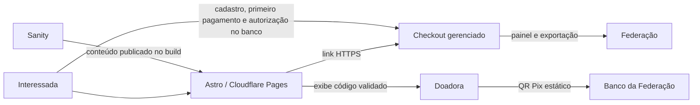

# Arquitetura proposta sem Sistema 2

**Estado: integração de avaliação Cakto implementada localmente; arquitetura definitiva condicionada à homologação.** Consulte [VIABILIDADE_PIX_AUTOMATICO.md](VIABILIDADE_PIX_AUTOMATICO.md). Nenhum fornecedor foi comprovado para todos os requisitos; por isso, o Sistema 2 permanece nesta branch. O link de filiação antigo foi substituído apenas na página pública de filiação, em modo local de avaliação.

## Componentes desejados

1. **Astro + Cloudflare Pages:** site institucional estático. Exibe conteúdo, orientações, termos e um link HTTPS para o checkout público. Não recebe dados pessoais nem chama API financeira.
2. **Sanity:** fonte de conteúdo editorial público. Poderá guardar textos institucionais, valor informativo, instruções, link público de filiação e dados públicos de doação depois da escolha da plataforma. Não deve guardar afiliadas, tokens ou documentos privados.
3. **Plataforma de filiação gerenciada:** cadastro, consentimentos, primeira mensalidade, autorização Pix Automático, recorrência, painel, exportação e cancelamentos. A Federação deve ser titular da conta e dar acessos individuais à equipe.
4. **Doação por Pix estático:** QR Code e código copia e cola fornecidos pela Federação, verificados antes de publicar. O site não atesta pagamento e não cria filiação.

## Estados que a operação deve separar

Formulário iniciado, cadastro criado, primeira cobrança pendente, primeira cobrança paga, autorização Pix pendente, autorização ativa, autorização recusada/revogada, mensalidade vencida e assinatura cancelada. A filiação financeiramente ativa exige **primeiro pagamento confirmado**. Pagamento inicial não prova autorização dos ciclos seguintes; [o Asaas documenta expressamente essa diferença](https://docs.asaas.com/docs/faq-2). O retorno do navegador ao site tampouco comprova pagamento.

## Configuração futura

No piloto, `PUBLIC_AFFILIATION_URL`, `TEST_AFFILIATION_AMOUNT` e `TEST_DONATION_PIX_CODE` existem somente no `.env` local e são usados com `CONTENT_SOURCE=demo`. Em produção, checkout, valor informativo, instruções, termos, privacidade e código Pix de doação têm o **Sanity como fonte única**. `PUBLIC_AFFILIATION_MODE=production` habilita a filiação somente quando os campos essenciais foram publicados. O QR de doação é gerado do código Pix validado, sem imagem separada que possa divergir. O valor efetivo da filiação é o do checkout; a Federação deve mantê-lo coerente com o site. Dados financeiros e afiliadas ficam na Cakto. Nunca publicar credenciais em `PUBLIC_*`.

## Limites

O site estático não consegue observar pagamento ou autorização. A plataforma escolhida precisa manter os registros e a equipe deve consultá-los no painel dela. Sem acesso à conta, contrato, checkout real e simulação oficial, não é possível afirmar que todos esses estados serão visíveis, que a associação será aceita ou que o Pix Automático está habilitado. A elegibilidade do recebedor e a participação do banco da pagadora podem mudar. Doações por QR estático requerem conferência no extrato bancário.

## Plano de migração depois da aprovação

1. Homologar fornecedor e conta institucional com os cenários de [viabilidade](VIABILIDADE_PIX_AUTOMATICO.md#critério-de-liberação).
2. Mapear registros existentes do Sistema 2 e definir exportação, retenção e acesso histórico antes da retirada; nunca apagar dados sem plano.
3. Configurar checkout, termos, privacidade e URL pública real; publicar um fluxo de teste sem transação real.
4. Ajustar site, CMS e doação com dados fornecidos. Verificar build, páginas e QR contra o código Pix.
5. Retirar código e dependências exclusivas do Sistema 2 somente após a operação nova estar comprovada; documentar o procedimento de corte e rollback.

