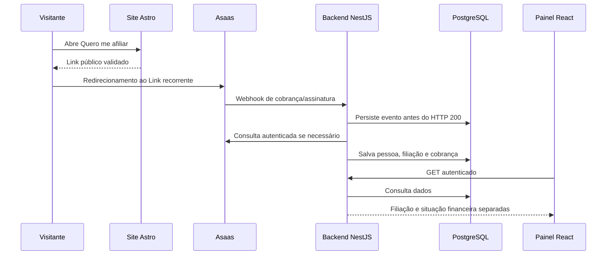

# 01 — Visão geral

O **Sistema 1** é o site Astro estático. Sanity é a fonte do conteúdo editorial durante o build. O **Asaas** hospeda as páginas de filiação e doação, coleta dados e mantém o estado das cobranças. O **Sistema 2** é o backend NestJS, banco PostgreSQL e painel React para consulta e decisões institucionais. Não há contrato HTTP direto entre o Sistema 1 e o Sistema 2. O site público continua exibindo notícias se o backend administrativo estiver fora do ar.

Um **webhook** é uma requisição enviada pelo Asaas ao backend quando acontece um evento. A **API** é a interface de requisições que o backend usa para consultar o Asaas e que o painel usa, com login, para consultar o próprio banco. A URL de retorno só navega o visitante; não confirma pagamento.



```mermaid
sequenceDiagram
  participant V as Visitante
  participant S1 as Site Astro
  participant A as Asaas
  participant B as Backend NestJS
  participant DB as PostgreSQL
  V->>S1: Abre Faça uma doação
  V->>A: Redirecionamento ao Link avulso Pix
  A->>B: Webhook da cobrança
  B->>DB: Persiste evento
  B->>A: Consulta cliente/cobrança
  B->>DB: Salva doação; não cria filiação
```

O vínculo usa `paymentLink` da primeira cobrança ou o ID `subscription` persistido para ciclos seguintes. Se não houver vínculo conhecido, o evento fica `UNRESOLVED` para conciliação, sem criar filiação por nome, e-mail, texto ou valor. Clientes repetidos do Asaas são mantidos com IDs externos únicos; não há fusão automática. O banco guarda decisões administrativas e a caixa de entrada de eventos. O dinheiro pretendido segue **pagadora → Asaas → conta Cora PJ**; o painel não atesta repasse bancário.
